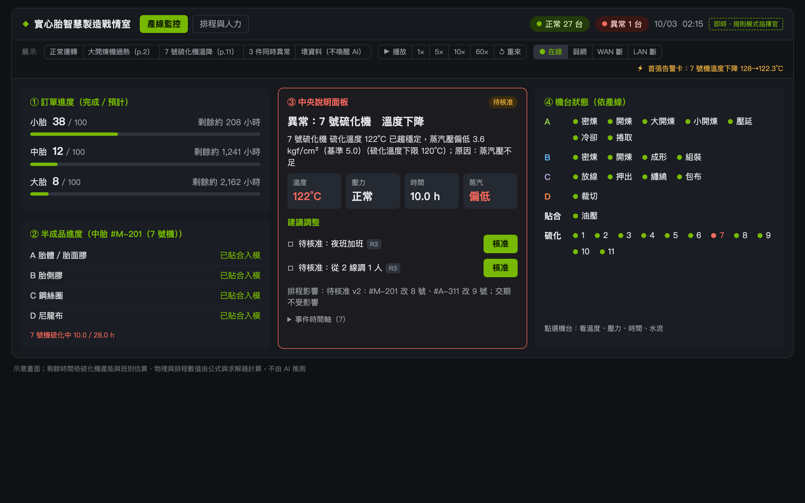

# 實心胎智慧製造戰情室 · Team Westie

2026 Agentic AI on the Edge Hackathon · 智慧製造組. 企劃書定稿：[`docs/proposal-final.pdf`](docs/proposal-final.pdf)（12 頁，以企劃書為準）。



---

## 中文（團隊用）

**新加入？先看 [`CONTRIBUTING.md`](CONTRIBUTING.md)（下載、執行、開 issue、分支、PR、規範）和 3 分鐘影片 [`docs/onboarding/team-onboarding.mp4`](docs/onboarding/team-onboarding.mp4)。**

### 這是什麼

一個畫面看完整座實心胎工廠：訂單、4 條產線、28 台機台、11 台硫化機，以及每個異常的處置進度。

- **事件偵測**（非 LLM，常駐）看感測器時序，預測會出事才喚醒 AI。目標：異常 1 分鐘內發現（原本人工巡檢 2 小時）。
- **事件狀態機**：分類 → 計畫 → 模擬 → 把關 → 執行 → 驗證 → 結案；預期沒達成就換假設重排，連續失敗就安全停止、保留原排程。
- **事件指揮官** 是唯一的 LLM（Nemotron 3.5 Lightning 30B-A3B NVFP4），只回一份 JSON 步驟計畫。硫化時間由 Arrhenius 公式算、排程由 OR-Tools CP-SAT 解、SOP 從 Qdrant 查 —— 物理和排程數字從不讓 AI 猜。
- **動作把關**（確定性）：白名單、4 級風險 R0–R3、格式檢查、模擬可行才放行。R2/R3 要主管在手機上核准。
- **安全核心**（確定性 PLC 規則）：煉膠 ≥120°C 停機、已加硫 ≥110°C 停機、硫化機 <120°C 扣模。LLM 不能呼叫也不能推翻，不等 AI 直接處置。
- **稽核日誌** 只能追加，有雜湊鏈與簽章，記錄每次狀態轉換、工具呼叫、核准與攔截。
- 全部跑在一台 DGX Spark 上，不連外網。

### 問戰情室（主管提問，只查不改）

手機頁最下方可以直接問：「7 號機現在怎樣？」「今晚夜班缺誰？」「大開煉機過熱怎麼處理？」。走的是同一套 Agent 架構：同一個 Nemotron 先選要查哪些唯讀工具（最多 4 步），程式只執行 `ASK_TOOLS`（讀感測器、異常預測、硫化公式、訂單班表、SOP），再由 Nemotron 只根據查詢結果回答。寫入工具、`solve_schedule`（會存提案排程）和清單外的名稱一律攔下並記 `INTERCEPTED`；每次提問以 `ASK-nnnn` 寫進同一份稽核日誌。LAN 中斷時只有現場觸控螢幕能問。程式：`warroom/agent/ask.py`、`POST /api/ask`，測試 `tests/test_ask.py`。

### 主控台是主畫面：下新任務、討論計劃（issue #10）

打開 `http://localhost:8000` 先看到主控台（產線監控在 `#monitor`，上方狀態列點一下就到）。輸入框有三種模式：

- **討論這個計劃**（有核准卡在等時預設）：例如「9 號機今晚要保養」「不要跨組調人」「選 A」。Nemotron 用 JSON schema 判讀（失敗或模式為 mock 時用關鍵字規則），程式把它變成可強制的條件（某台硫化機某時段不可用、不加班、不跨組調人、偏好方案），套用到每次排程求解並檢查結果；舊卡作廢（寫入稽核、不能再核准），發新卡 v2 並列出改了什麼。問題只查不改；做不到的要求會直說。每個事件最多討論重排 3 次。
- **下新任務**：例如「通知維修組明早檢查 3 號機」。開一個主管指令事件，走 計畫 → 模擬 → 把關 →（R2/R3 核准）→ 執行 → 結案，全部寫入稽核。要動到機台或 PLC 的指令（例如「把 7 號機搬走」）不開工具，直接說明做不到。
- **只查不改**：問戰情室（見下）。打招呼、道謝會簡短回覆、不查任何資料；看不懂的不會猜機台。

程式：`warroom/agent/talk.py`（規則與條件）、`warroom/agent/discuss.py`（討論）、`StateMachine.open_command / discuss_replan`、`POST /api/command`、`POST /api/events/{id}/discuss`；排程求解器支援 `press_blackouts`。測試 `tests/test_plan_talk.py`，無頭 e2e `node web/e2e/plan-talk.mjs http://localhost:8000`。

### 突發狀況與早班開工：核准後人員去執行（issue #17）

展示列（也就是 3D 戰情室電腦裡的儀表板）多了三個情境，都不是機台故障，而是工廠事件：

- **早班開工**（10/05 08:00）：查今日訂單、出勤（含團隊資料集的請假）、SOP-02 暖機順序、原料 → 一張「今日計畫」核准卡（派工 R2）。
- **插單**（10/07 10:00）：急單 #R-009（依團隊資料集 SO-009 改編）加入訂單簿 → CP-SAT 重排 → 卡片列出哪些訂單完工延後幾小時、有沒有誤交期 → 核准。
- **人力調度**（10/06 07:30）：加硫組 S13 來電請病假，硫化機組早班缺 1 人 → 求解器提出 A 加班／B 從 2 線調 1 人 → 核准。

核准後，**程式**（不是模型）把每個核准步驟轉成人員任務（誰、去哪、做什麼、預計幾點完成）：工人在 3D 走過去做，任務狀態 待派 → 前往中 → 執行中 → 完成 即時更新並寫入稽核（`task`）。工廠事件的驗證等所有任務完成才結案；機台事件（p.11、p.2）的任務照樣派、照樣追蹤，但驗證仍以讀值為準。每條胎有狀態與進度圈：待補料 → 備料中 → 生產中 → 硫化中 → 完成 → 待出貨 → 已出貨；訂單的補料任務沒完成前，它的胎停在「待補料」。程式：`warroom/sim/work.py`、`StateMachine.open_plant_event`；測試 `tests/test_plant_events.py`。

### 一日循環：預設的正常運轉（issue #36）

不選情境時，工廠跑「一日循環」：團隊資料集 2026-10-21 一整天（資料集裡唯一沒有腳本事件的完整一天；10/22 有 EV-1、10/28 有 EV-2，10/23–10/27 沒有資料）。A03 大開煉機、A04 小開煉機、A06 冷卻機、V06–V08 硫化機播放當天實際曲線（10 秒一筆，中間線性內插、70 秒移動平均；A03 當天 ±3.7°C 的慢擺幅縮成 ±2°C，否則偵測器會把最慢的爬升當成過熱），其餘 22 台由模擬器在同一天運轉、用當天班表。24:00 回到 00:00：開著的事件取消、排程回到當天第一版、機台／訂單／貨品／人員／卡車回到當天起點、偵測器重新學基準，稽核日誌記一筆「新的一天（循環 n）」。畫面時間旁顯示「一日循環・第 n 輪」；展示列可跳到 08:00 開工、10:00 出貨、16:00 出貨、24:00 換日（照常快轉過中間的時間）。

當天有完整的訂單到出貨：#W-0397 06:30 完成、10:00 出車，#W-0396 13:30 完成、16:00 出車；09:10、10:40 各進一張新單（後者是急單）。訂單完成與出貨出廠是世界事件 `order_completed`、`shipment_departed`（訂單號、條數、是否準時），寫入稽核、經 `/ws` 送出；3D 工廠跳出「訂單 #X 完成」「出貨 #X 已出廠（n 條）」並在碼頭放彩帶。程式：`warroom/sim/day_loop.py`、`Runtime._wrap_day`；測試 `tests/test_day_loop.py`。

展示列的情境按鈕現在帶情境自己的速度，並先在背景快轉到故障前 15 秒；情境切換在背景執行緒建廠，畫面不再卡住。7 號機溫降從按下到核准卡：152.6 秒 → 16.6 秒（Mac、規則模式，量測於 2026-10-20）。

### 模擬事件：展示時讓工廠自己出狀況（issue #36）

展示列多了 **隨機事件** 開關（3D 工廠按 `4` 也一樣）：打開後每 10／30／60 個模擬分鐘，從加權清單抽一件事件——硫化機蒸汽壓不足、蒸汽洩漏、開煉機冷卻水不足、感測器壞資料（不叫醒 AI）、急單插單、人員請病假、原料到貨延遲、原料缺料（一批驗退）。**觸發事件 ▾** 可以立刻觸發指定的一件。事件不走捷徑：機台故障注入模擬器（和 `/api/sim/fault` 同一條路），要被事件偵測從讀值看出來；插單、病假是工廠事件，由狀態機開事件、寫入一律經閘門（Action Gate）；原料延遲與缺料只改變工廠全貌的庫存與到貨並寫入動態，缺料核准卡由 #38 的巡檢負責。預設關閉；同一個種子（seed，預設 36）抽出同一串事件；關閉時 p.11 腳本結果不變（`tests/test_sim_events.py`）。程式：`warroom/sim/events.py`、`Runtime.fire_sim_event`；API：`GET/POST /api/sim/events`、`POST /api/sim/events/fire`。

### 3D 工廠（戰情室負責人視角）

打開 `http://localhost:8000/factory`。你是戰情室負責人，以第一人稱站在一座迷你工廠廠房裡（產線、戰情室、員工待命區、卸貨碼頭），從戰情室門口出發，面向產線。畫面全部接即時資料（同一條 `/ws`），28 台機台的燈號：綠＝正常、黃＝注意、紅＝異常／停用；靠近機台會浮出簡稱＋溫度。

- 點一下畫面開始（鎖定滑鼠看四周）。`W A S D` 走、`Shift` 跑、滑鼠或 `Q`/`E`（方向鍵）轉向、`Esc` 放開滑鼠。`V` 切換俯瞰（娃娃屋視角）。
- 戰情室牆上的大螢幕就是真的儀表板（`/`），即時更新。走到戰情室桌前按 `F` 坐下：真的儀表板全畫面打開，可切分頁、用上方展示列啟動 p.11「7 號硫化機溫降」、核准；`Esc` 或 `F` 起身。走到機台前按 `F`：開即時讀數。
- 廠房牆上有兩扇門：**休息區**（半場籃球場）和**廁所**是另外的空間，走進門或按 `F` 傳送過去，再從門口走回工廠。在哪裡都收得到核准通知。
- `P` 拿起主管手機：手上的就是真的 `/phone` 頁，可直接核准／駁回、打字問戰情室；`P` 或 `Esc` 放下。有新的待核准時手機會震動、響鈴，畫面上方跳通知。
- 每台機台頭上都有進度圈（issue #36）：人員任務（暖機、檢修、補料…）優先，其次是維修、異常（紅色全圈）、目前這一批／這一模硫化的進度；閒置只留一個淡色小點。正在硫化或備料的機台，任務圈疊在貨品圈上方。
- 低多邊形、全部程式產生，不下載模型。程式：`web/src/factory3d/`；無頭測試：`node web/e2e/factory3d.mjs http://localhost:8000`（截圖在 `web/e2e/screenshots/factory-*.png`）。

### 一行啟動（Mac，Apple Silicon）

需要：[uv](https://docs.astral.sh/uv/)、Node.js 20+ 與 pnpm（`corepack enable pnpm`）。第一次執行會下載 Python 套件、pnpm 套件和 SOP 嵌入模型（數百 MB，之後離線可用）。

```bash
./start.sh            # 模擬模式：不需要任何模型，整個展示用規則指揮官跑完
./start.sh ollama     # Ollama 模式：Nemotron 3.5 Lightning NVFP4（先跑一次 deploy/mac/dev.sh pull，約 23 GB）
```

打開 `http://localhost:8000`（戰情室）、`http://localhost:8000/phone`（主管手機）和 `http://localhost:8000/factory`（3D 工廠）。用真手機從廠內 Wi-Fi 核准時，先設 `WARROOM_SUPERVISOR_PIN=<8 碼以上>` 再啟動，手機頁會要求輸入。

團隊正式資料集回放（`data/team_dataset/`，隊友做的合成資料）：`WARROOM_REPLAY=team_both ./start.sh`（或 `team_ev1` 大開煉機 112°C、`team_ev2` 7 號硫化機 119.5°C），在「正常生產」情境播放資料集的感測器曲線。

不開瀏覽器、只看時間軸：

```bash
uv run python -m warroom.api demo --scenario press7_temp_drop --seconds 1200 --auto-approve
```

### 在 DGX Spark 上跑

```bash
sudo WARROOM_SUPERVISOR_PIN=<pin> deploy/bin/install_spark.sh   # 趁還有網路：拉映像、下載權重、裝 systemd、開機防火牆
sudo systemctl start warroom-stack                              # vLLM（NVFP4 + DSpark 推測解碼 + prefix cache）+ Qdrant + MQTT + app
curl -s 127.0.0.1:8000/api/health
```

- 堆疊：`deploy/spark/docker-compose.yml`、vLLM 參數 `deploy/spark/vllm-serve.sh`、環境 `deploy/spark/.env.example`。
- 開機自啟 + 模型預載 + watchdog：`deploy/systemd/`、`deploy/bin/watchdog.sh`、`deploy/bin/preload.sh`。
- 離線更新 / 一鍵回復：`deploy/update/offline_update.sh`、`deploy/update/rollback.sh`。
- 沙箱（NemoClaw/OpenShell）：`deploy/openshell/run_sandboxed.sh`；對外網路白名單：`deploy/network/`。
- 安全核心獨立程序（PLC 替身）：`uv run python -m warroom.safety.plc --demo`。
- 第 10 頁量測：`bench/spark_ablation.sh`（FP8 無快取無推測解碼對照組 + 各項最佳化貢獻），`bench/py.sh -m bench.report` 產生 `bench/results/SUMMARY.md`。

### 決賽展示流程（對應企劃書第 11 頁）

完整台詞與點擊順序：[`docs/DEMO-SCRIPT.md`](docs/DEMO-SCRIPT.md)。精簡版：

1. 戰情室在展示列點 **7 號硫化機溫降（p.11）**，速度 **10×**。用真模型時先暖機（第一次載入約 82 秒），見 DEMO-SCRIPT。
2. [02:14:00] 事件偵測：7 號 128→122°C，預測穩定 122±1 → 喚醒指揮官。[02:14:01] 安全核心：仍在 120–130，不停機。
3. 指揮官假設 H1 蒸汽壓不足；拆 S1 硫化公式、S2 訂單班表 → S3 排程 → S4 確認（需核准）→ S5 通知；預期 30 分內 ≥121°C。
4. S1：122°C 總需 **36.5 h（+8.5 h）**；S2：#A-311 交期 3 天後、10/03 夜班缺 1 人；S3：**#A-311 移到 9 號機**、夜班從 2 線調 1 人，交期全部滿足。
5. 手機跳出第一輪核准（R3）→ 選 **B 從 2 線調 1 人** → 核准，寫入稽核日誌。
6. 切 **60×**。[02:28:50] 掉破 120°C，安全核心直接扣模（不等 AI）。[02:31:00] 程式驗證 119.5°C → **H1 不成立**。
7. 指揮官換 **H2 持續洩壓或感測器漂移**，對照同管線 6、8 號機，查 SOP〈硫化中斷處置〉→ 7 號機停用、重排。
8. 手機第二輪「CURE-07溫度下降，需重排」（將做：7 號機停用）→ 主管改選 **A 夜班加班** → 核准；決定與理由寫入紀錄，排程 v3 生效，舊版可一鍵回復。
9. **拔網路線**：在 Spark 上拔 WAN 線，戰情室照常、手機走廠內 LAN；Mac 上點 **WAN 斷 / LAN 斷** 示範第 9 頁三層離線（LAN 斷 → 現場觸控螢幕 + 警示燈）。正式判定：`sudo -E bench/py.sh -m bench.unplug_test --unplug <wan介面> --app-url http://127.0.0.1:8000`。
10. 切到 **排程與人力** 分頁看重排後的甘特圖。

備用展示：**大開煉機過熱 (p.2)** —— A 線大開煉機 112°C 上升，✓ 已自動通知維修冷卻水路、☐ 待核准放慢生料投入、排程影響「無，大胎 #07 仍 17:00 入硫化機」。

---

## English

### What it is

A single-screen war room for a solid-tire plant (4 lines, 26 processes, 28 machines, 11 curing presses — the bottleneck). Always-on event detection wakes a deterministic event state machine; one LLM (the Event Commander) returns a JSON step plan; read/compute tools run automatically; write tools pass a deterministic Action Gate and, at R2/R3, a supervisor's phone approval; a deterministic Safety Core acts on its own and cannot be called or overridden by the LLM. Everything runs on one DGX Spark with no internet.

### Quick start (Mac, Apple Silicon)

Needs [uv](https://docs.astral.sh/uv/), Node.js 20+ and pnpm (`corepack enable pnpm`). The first run downloads Python and pnpm packages and the SOP embedding model (a few hundred MB); after that it runs offline.

```bash
./start.sh            # mock mode: no model, the whole demo runs on the rule-based commander
./start.sh ollama     # Ollama mode: Nemotron 3.5 Lightning NVFP4 (run deploy/mac/dev.sh pull once, ~23 GB)
```

Open `http://localhost:8000` (dashboard), `http://localhost:8000/phone` (supervisor phone) and `http://localhost:8000/factory` (3D factory). For a real phone on the LAN, start with `WARROOM_SUPERVISOR_PIN=<8+ chars>`. Other knobs: `PORT` (mock mode only: in `./start.sh ollama` mode `deploy/mac/dev.sh` reuses `PORT` as the Ollama port, so the app ends up on :11435; see the demo script for the manual command), `SCENARIO` (`normal`, `press7_temp_drop`, `open_mill_overheat`, `bad_data`, `concurrent_3`, and the issue #17 plant events `shift_start`, `rush_order`, `staffing`), `SIM_SPEED`, and for any OpenAI-compatible server `LLM_MODE=llm BASE_URL=... MODEL=... [NVIDIA_API_KEY=...]`.

Manual steps, if you prefer: `uv sync` · `cd web && pnpm install --frozen-lockfile && pnpm build` · `uv run python -m warroom.api serve`. Tests: `uv run pytest -q`. Headless timeline: `uv run python -m warroom.api demo --scenario press7_temp_drop --seconds 1200 --auto-approve`.

### Running on the DGX Spark

See the Chinese section above for commands. `deploy/bin/install_spark.sh` pulls images and weights while online, writes `/opt/warroom/releases/<ver>`, installs the systemd units (stack, preload, watchdog, firewall) and refuses to finish without a supervisor PIN. After that the box boots straight into the war room with the model preloaded and all non-LAN egress dropped.

### Finals demo

Step by step, with what to click and what to say: [`docs/DEMO-SCRIPT.md`](docs/DEMO-SCRIPT.md). It follows page 11 minute by minute and ends with the page-9 unplug.

### The four judging thresholds → code

| Threshold (p.7) | Where it lives |
|---|---|
| 1. Goal & decomposition by the commander (S1 cure ∥ S2 orders → S3 solve depends on both → S4 approve → S5 notify) | `warroom/agent/commander.py` (OpenAI-compatible client, `CommanderPlan` JSON schema, xgrammar/`json_schema` constrained output, reasoning off), `warroom/agent/state_machine.py` (`resolve_refs` for `$S1.total_cure_h`, dependency-ordered SIMULATE), `CommanderPlan` / `PlanStep` in `warroom/contracts.py` |
| 2. Tools opened by state | `TOOLS_BY_STATE`, `READ_COMPUTE_TOOLS`, `WRITE_TOOLS` in `warroom/contracts.py`; enforced in `StateMachine._call` (`warroom/agent/state_machine.py`, off-state calls logged `INTERCEPTED`); tools in `warroom/tools/` (`cure.py` Arrhenius, `impl.py`, `registry.py`), CP-SAT in `warroom/schedule/solver.py`, Qdrant SOP KB in `warroom/kb/` |
| 3. State & dynamic adjustment (miss → swap hypothesis & replan; retry once → SOP path; solver timeout → backup; 2 failures → keep schedule) | `ALLOWED_TRANSITIONS`, `MAX_TOOL_RETRIES=1`, `MAX_CONSECUTIVE_FAILURES=2` in `warroom/contracts.py`; code-only VERIFY and REPLAN in `warroom/agent/state_machine.py`; `FallbackScheduler` (CP-SAT → heuristic, `fell_back=True`) in `warroom/schedule/solver.py`; SAFE_STOP keeps the active schedule |
| 4. Permissions & risk (approval for feed pause / staff moves, 4 levels, no actuator permission, intercepts logged, feasible-only, one-click rollback) | `RuleGate` in `warroom/agent/gate.py` (R0–R3, allow-list, format, simulation-feasible); `ApprovalBrokerImpl` in `warroom/agent/approvals.py`; append-only hash-chained `JsonlAuditLog` in `warroom/agent/audit.py`; versioned `FileScheduleStore.rollback` in `warroom/schedule/store.py`; Safety Core in `warroom/safety/core.py` (and `plc.py` as a separate process; a test forbids it importing agent/tools/api/LLM clients); no actuator/PLC write tool exists anywhere |

### Ask the war room (read-only supervisor Q&A)

The phone page has a 問戰情室 box. It is not a second agent: the same Nemotron picks up to 4 read steps (JSON, schema-constrained), code runs only `ASK_TOOLS` (read sensors, predict, cure formula, orders/shifts, SOP) through the same registry, and the model then answers from those results only (numbers copied, never estimated). Write tools, `solve_schedule` (it stores a PROPOSED version) and names off the allow-list are refused and logged `INTERCEPTED`; every question, call and answer goes into the same hash-chained audit log under an `ASK-nnnn` id. Same session rule as approvals (PIN on the LAN, on-site only when the LAN is down). Code also checks the answer: a number that is not in the tool results replaces the model's answer with the results, and a change request (停掉, 重排, 調人...) never gets a model-written answer. The check covers numbers only, not wording (a real-model run once called press 7 「正常運作」). Mock mode uses keyword rules and a template answer; an invalid plan or a model failure falls back to them. Real Nemotron on the Mac (Ollama, 2026-10-18): 5 questions, 0 fallbacks, 0.5–3.2 s each once loaded. Code: `warroom/agent/ask.py`, `POST /api/ask`; tests: `tests/test_ask.py`.

### Day loop: the default running state (issue #36)

With no scenario chosen, the plant plays one day of the team dataset (2026-10-21, the only full day without a scripted event) from 00:00 to 24:00 and wraps back to 00:00 with no freeze and no false alarm: open events are cancelled, the schedule, machines, orders, goods, people and trucks return to their start-of-day state, the detector relearns, and the audit log records 「新的一天（循環 n）」. The six dataset machines replay that day's curves (A03's ±3.7 °C swing scaled to ±2 °C); the other 22 run the simulator on the same date and roster. The day carries a full order-to-shipment chain, with `order_completed` and `shipment_departed` world events (order id, qty, on time) shown as a success moment in the 3D factory. Demo buttons now send their scenario speed and pre-roll to 15 s before the fault; the scenario build runs off the event loop (press-7 button to approval card: 152.6 s → 16.6 s, Mac, rule mode).

### Simulated events (issue #36)

The demo strip has a **隨機事件** (random events) switch, also key `4` in the 3D factory: every 10 / 30 / 60 factory minutes it draws one event from a weighted list (steam pressure drop, steam leak, cooling-water drop, a bad sensor sample that must not wake the AI, rush order, sick call, late delivery, a stock-out). **觸發事件 ▾** fires a chosen one now. Machine events are sim faults the detector has to find in the readings; order and people events are plant events the state machine opens, with every write through the Action Gate; material events only move the world's stock and deliveries (the shortfall card is #38's patrol). Off by default; one seed gives one sequence; page 11 is unchanged while it is off (`tests/test_sim_events.py`). Code: `warroom/sim/events.py`; API `GET/POST /api/sim/events`, `POST /api/sim/events/fire`.

### 3D factory (the war-room lead's view)

Open `http://localhost:8000/factory`. You are the war-room lead, in first person, inside a miniature factory building (production lines, war room, staff corner, loading dock), starting at the war-room door facing the lines. Everything is live data from the same `/ws`: each of the 28 machines has a status light (green normal, amber warning, red alarm / out of service) and shows its short name and temperature when you walk near.

- Click to start (pointer lock for mouse look). `W A S D` walk, `Shift` run, mouse or `Q`/`E` (arrow keys) to turn, `Esc` releases the mouse. `V` toggles the dollhouse overview.
- The big screen on the war-room wall is the real dashboard (`/`), live. `F` at the war-room desk sits you down at the computer: the real dashboard opens full-size (tabs, the demo strip to start the p.11 press-7 temperature drop, approvals); `Esc` or `F` stands up. `F` at a machine opens its live readings.
- Two doors on the hall walls lead to the **break area** (half court) and the **restroom**, which are separate spaces: walk into the door or press `F` to go there, and back the same way. Approval alerts reach you anywhere.
- `P` raises the supervisor phone: it is the real `/phone` page, so you can approve / reject and type into 問戰情室; `P` or `Esc` lowers it. A new pending approval buzzes the phone, rings and shows a toast.
- Every machine has a progress ring overhead (issue #36): a worker task there first (warm-up, repair, feeding), then maintenance, an alarm (full red), then the current batch or cure; idle machines show a small dim dot.
- Low-poly and fully procedural, no model downloads. Code: `web/src/factory3d/`; headless check: `node web/e2e/factory3d.mjs http://localhost:8000` (screenshots in `web/e2e/screenshots/factory-*.png`).

### Measured numbers vs targets

Only numbers actually measured are listed. Mac rows are an Apple M4 Max 64 GB running Ollama 0.33 (MLX) with `nemotron-3.5-lightning:30b-a3b-nvfp4` — a stand-in for the Spark, not the Spark. Raw JSON is in `bench/results/`, the generated table in `bench/results/SUMMARY.md`.

| Metric | Target | Measured | Where | Verdict |
|---|---|---|---|---|
| Test suite | green | 582 passed, 3 skipped (13 min) | Mac | pass |
| Page-11 event end to end, real model | closes, numbers match p.11 | closed; 36.5 h (+8.5 h), #A-311 → 9, night short 1, verify 119.5 °C → H2 | Mac, Ollama | pass |
| Page-6 weekly output per press S/M/L (DES check of the proposal table) | 6/5/3 · 6/5.9/4.5 · 7/6/4.9 | 6/5/3 · 6/6/4.82 · 7/6/4.89 | `warroom/schedule/capacity.py` | within ±0.1 except M "extend shifts" (6 vs 5.9) |
| Page-6 lead time M&L / small | 13.3 → 9.3 wk / 2.4 → 2.0 wk | 13.2 → 9.4 wk / 2.5 → 2.1 wk (DES) | same | close; table shows the proposal values |
| Safety core decision time (28 machines per tick) | < 0.2 s | p99 0.058 ms, max 0.104 ms (n=1500) | Mac, compute only, not sensor→PLC | pass |
| First alert card, cold, p90 | ≤ 2 s | 1.85 s (n=5, ~5.6k-token prompt) | Mac, idle host | pass |
| Full event, real state machine, p50 | ≈ 22 s | 16.2 s (3/3 closed, plans 100 % valid) | Mac | pass |
| TTFT warm 32k, p90 | ≤ 0.5 s | 4.51 s (p50 0.118 s) | Mac | fail on Mac; Spark pending |
| 3 concurrent anomalies, worst alert | each ≤ 4 s | 22.7 s; Ollama/MLX queued instead of batching (sequential each ≈ 2.1 s) | Mac | fail on Mac; needs vLLM batching on the Spark |
| Decode throughput | publish | 99.8 tok/s single stream | Mac | measured |
| Unplug: alert offline / outbound connections | ≤ 2 s / 0 | 0 outbound connections in 120 s + one event; first commander card 6.83 s (commander TTFT 5.9 s on a 5.2k-token prompt) | Mac, process-level `sandbox-exec` block, no cable pulled | outbound pass; alert ≤ 2 s fail on Mac |

**Pending on the DGX Spark** (not measured, no Spark here): memory band 36–50 GB with the full stack at 32k context (the Mac run was UNJUDGED: app not running, model at 16k); TTFT ≤ 0.5 s at 32k with vLLM prefix cache; 3 concurrent ≤ 4 s each with vLLM batching; NVFP4 vs FP8 ≤ 3 points on vLLM (Mac Ollama NVFP4 vs MXFP8 runs exist but are marked stale after bench code changed); tokens/W (needs a wall-plug meter); the FP8 / no-cache / no-spec-decode control group and per-optimisation contributions (`bench/spark_ablation.sh`); the physical cable-pull unplug with the nftables block.

### Known gaps

- No DGX Spark was available: every model number above is from a Mac/Ollama stand-in. The vLLM, NVFP4 kernel, DSpark speculative decoding and nftables paths are written and unit-tested but not run on GB10 hardware.
- The sensor side is simulated (data replay + fault injection). There is no real Modbus/OPC UA client; the sim stands in for the gateway and readings take an MQTT hop only with `WARROOM_INGEST=mqtt`.
- The page-10 INT8 time-series model is replaced by a fitted detector (EWMA + curve fit) in `warroom/detect/`.
- Orders and shifts come from seed data or an Excel import (`data/orders_seed.xlsx`); there is no MES link, as the proposal states.
- NeMo Agent Toolkit is an optional plugin (`warroom/natkit/`, `deploy/nat/run.sh`); it is not a base dependency because its profiler pins older pandas/rich.
- OpenShell/NemoClaw sandboxing (`deploy/openshell/`) needs the OpenShell CLI and gateway on the Spark; on the Mac the offline proof is a process-level `sandbox-exec` block.
- On the Mac the 3-concurrent and 32k-TTFT targets fail: Ollama on MLX does not batch concurrent requests and its prefix cache is less consistent than vLLM's. These are judged again on the Spark.
- The first run needs internet once to download the SOP embedding model (fastembed); the Spark installer pre-fetches it.
- Page 11 round 1: the solver moves #A-311 to press 9 and, as a knock-on, one later #M-201 tire from press 9 to press 8, so the timeline and the round-2 已做 row also name 「#M-201 改 8 號」. #A-311 is a large (L) tire in the seed and the Excel workbook; its 34 h cure pushes press 9's own queue. Seeding it as a medium tire removes the knock-on but breaks the page-2 100/100/100 totals and makes round 2 move #A-311 again, so the seed is left as is.
- Activation energy 85 kJ/mol is the proposal's assumed value, not a measured compound property.

### Layout

`warroom/` Python (contracts, factory model, sim, detect, safety, tools, schedule, kb, agent, api) · `web/` Vite + React dashboard and phone page · `deploy/` Mac and Spark stacks, systemd, firewall, sandbox, offline update · `bench/` page-9/10 benchmarks · `tests/` pytest · `docs/` proposal, architecture, demo script, screenshots · `legacy/` the superseded first prototype.
